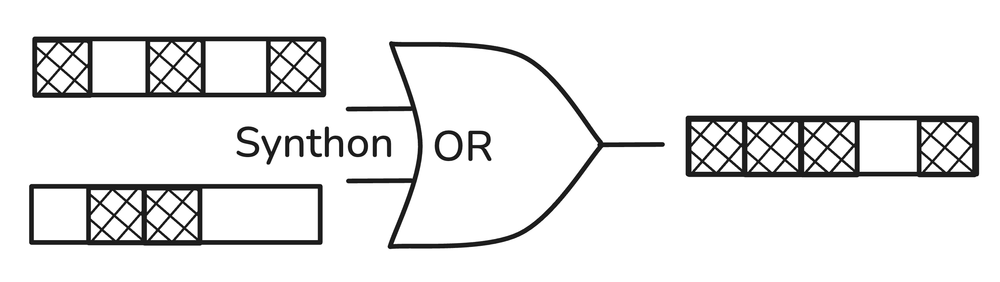
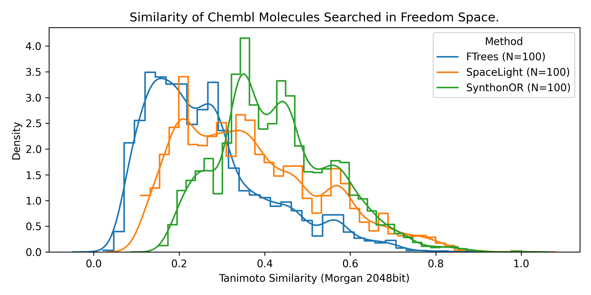

# synthonor

[](https://pypi.org/project/synthonor/)
[](https://synthonor.mireklzicar.com/)

Open source synthon similarity search with a bitwise OR strategy and support of generic fingerprints (ecfp4, rdkit, atom pair, topological torsion...)



## Install

```bash
pip install synthonor
```

## Database Availability

SynthonOR expects a tab-separated table with these concepts:

```text
smiles  synthon_id  position  reaction_id
NC(=O)[C@@H]1CCCN1[U] 100000003125 1  11a
C[C@@H](O)[C@H](N[U])C(N)=O 100000003557 1  11a
CCCN([U])C(C)C(=O)Nc1ccccc1C  100000003669  1 11a
O=C1CN([U])[C@@H](c2ccccc2)CO1  100000005368  1 11a
```

The package ships with a bundled example synthon slice (`synthon_space_1M.tsv`).
The repo also includes the matching reaction schema table used by the exact
benchmark script.

## Quick Start (Python)

```python
from synthonor import (
    build_synthon_fingerprint_cache,
    example_space_path,
    load_synthon_or_index,
    search_smiles,
)

data_path = example_space_path()
cache_info = build_synthon_fingerprint_cache(data_path)
index = load_synthon_or_index(data_path)

hits = search_smiles(
    "CCOc1ccc(NC(=O)N2CCN(CC2)C)cc1",
    index,
    top_n=25,
)

print(cache_info.cache_prefix)
print(hits[0].reaction_id, hits[0].synthon_ids, round(hits[0].approx_score, 3))
```

`example_space_path()` returns a normal writable local path to the bundled
example TSV, so the first cache build can live right next to it. The default
fingerprint is `ecfp4`.

Fingerprint-based search:

```python
from synthonor import query_fingerprint_from_smiles, search_fingerprint

query_fp = query_fingerprint_from_smiles("CCN1CCN(CC1)C(=O)c1ccccc1", index.fingerprint_spec)
hits = search_fingerprint(query_fp, index, min_score=0.35, preset="very_accurate")
```

## Benchmark Snapshot

In the `chembl_33_100` benchmark, `100` ChEMBL molecules were searched against `FreedomSpace_140bn_2025-07`, the top `100` assembled neighbors per query were collected, and exact Morgan `2048`-bit (`ECFP4`-style) Tanimoto similarities were recomputed on the returned products for an apples-to-apples comparison; the count-matched distribution below shows `synthonor` shifted clearly to the right of `SpaceLight` and `FTrees`, meaning it retrieves more fingerprint-similar molecules on this slice on average (mean count-matched Tanimoto `0.427` vs `0.371` for `SpaceLight` and `0.266` for `FTrees`).



## CLI

Build or validate cache only:

```bash
synthonor path/to/syntons.tsv \
  --fingerprint ecfp4 \
  --build-cache-only
```

Run search:

```bash
synthonor path/to/syntons.tsv \
  --query "CCOc1ccc(NC(=O)N2CCN(CC2)C)cc1" \
  --top-n 25 \
  --output synthonor_hits.jsonl
```

Run explicit self-test mode:

```bash
synthonor path/to/syntons.tsv --test --preset fast --top-n 5
```

## Search Contract

- `top_n=N`: return at most `N` hits, sorted by descending approximate score.
- `min_score=S`: return every hit with approximate score `>= S`.
- `min_score=S, top_n=N`: apply score cutoff first, then cap to `N`.
- `max_score=T`: optionally bound score from above.
- returned `rank` values are ranks within the filtered output.

Config precedence:

- use `preset="fast" | "accurate" | "very_accurate"` for standard workflows
- pass `config=SearchConfig(...)` for explicit control
- explicit `config` overrides preset defaults
- explicit `top_n` overrides `config.topk_products`

## Search Presets

- `fast`: default setting; up to `8` reaction routes, `64` candidates per slot,
  `50k` exhaustive tuple limit
- `accurate`: searches all prescreened reactions with `192` candidates per slot
  and a `250k` exhaustive tuple limit
- `very_accurate`: same route coverage as `accurate`, with `256` candidates per
  slot and a `500k` exhaustive tuple limit

## Package Contents

After `pip install synthonor`, installed artifacts include:

- Python package code under `synthonor`
- bundled example TSV exposed via `synthonor.example_space_path()`, which materializes a writable local copy
- bundled benchmark reaction schema table under `synthonor.data`

Repo-only artifacts that are not installed by default:

- local cache files you generate such as `*.synthon_fp_cache.*`
- notebooks in `notebooks/`
- local test/result outputs

## Benchmark Snapshot

Headline results below come from the exact full-product benchmark on the
bundled `synthon_space_1M.tsv` slice (`6273` synthons, `42` reactions), using
the matching bundled reaction schema table and `10` deterministic queries.

| fingerprint | fast overlap | fast wall time / query (s) | accurate overlap | accurate wall time / query (s) |
| --- | ---: | ---: | ---: | ---: |
| `ecfp4` | `56.2` | `0.963` | `63.9` | `7.337` |
| `ecfp6` | `49.7` | `0.925` | `56.6` | `7.376` |
| `topological_torsion` | `30.2` | `0.874` | `33.4` | `7.455` |
| `rdkit` | `20.9` | `1.110` | `25.4` | `7.520` |
| `atom_pair` | `9.8` | `1.202` | `13.8` | `7.572` |
| `patternfp` | `2.2` | `1.215` | `2.2` | `7.509` |

- `fast` is now the default because it captures most of the retrieval quality
  at roughly `1 s/query` on this bundled example.
- `accurate` improves overlap further, but costs about `7.3-7.6 s/query`.
- `ecfp4` remains the strongest overall default fingerprint on this benchmark.

## Reproducible Scripts

From the repo root you can materialize the bundled synthon caches for every
bit-fingerprint family:

```bash
python scripts/build_example_fingerprint_caches.py
```

And you can run the exact full-product retrieval benchmark on the bundled
`synthon_space_1M` slice without relying on sibling repos:

```bash
python scripts/run_exact_full_product_retrieval.py
```

Outputs land under `results/` by default.

## Layout

- `src/synthonor/fingerprints.py`: fingerprint and similarity helpers
- `src/synthonor/synthon_or_rdkit.py`: cache build/load, index loading, search implementation
- `src/synthonor/resources.py`: bundled data helpers (`example_space_path`)
- `notebooks/001_minimal_implementation.py`: minimal end-to-end implementation
- `notebooks/002_basic_usage.py`: bundled database workflow
- `notebooks/003_cli_quickstart.py`: command-line quickstart
- `notebooks/004_adding_databases.py`: preparing custom TSV databases
- `notebooks/005_different_fingerprints.py`: comparing bit fingerprint families

## Exact-match integration (review branch)

The `exact-match-fix` branch adds `ProductSearchEngine` for assembled-product retrieval.
It calls the private shared `dmc-synthon-core` identity implementation; the
inverse algorithm is not copied into this repository. This integration is
available for review on the dedicated branch before merging or releasing.

Use Python 3.11 or 3.12 and install the authorized private core checkout at
commit `c5d40bacc45fb41b7c18a2c523999cf22dba9805` (version 0.4.6), alongside
this SynthonOR branch checkout. Ordinary SynthonOR imports and approximate
search do not require the private core. The product engine raises an explicit
installation error if it is unavailable.

```python
from synthonor import ProductSearchEngine

# index is a loaded SynthonORIndex. Implement this callback with the space's
# actual forward assembler; rows are original index row IDs in slot order.
# Return product SMILES, or None when the tuple cannot assemble.
engine = ProductSearchEngine(index, assemble, cache_dir="./identity-cache")
products = engine.search(query_smiles, top_n=100)
for product in products:
    print(product.smiles, product.score, product.hit.synthon_ids)
```

Construct the engine once per space and reuse it. For template-based spaces,
pass `reference_reactions={route_id: forward_rdkit_reaction, ...}` using the
actual forward templates. Identity proposals are accepted only after forward
assembly reproduces the exact canonical isomeric query. A verified proposal
replaces one candidate within `top_n`; the candidate pool is not enlarged.
Products are deduplicated and sorted by full-product fingerprint similarity,
with exact isomeric identity first on ties. Score bounds apply to full-product
scores. `product.hit.approx_score` remains the actual synthon-union score;
`product.hit.rank` is proposal metadata, not the final product-list position.

Identity search uses bounded work and falls back to ordinary candidate search
when it finds no verified identity; a miss does not prove absence. The existing
`search_smiles`, fingerprint-only API, and CLI retain their approximate search
contract. Product retrieval needs the assembler callback and therefore uses
this explicit API. No package release is part of this review branch.
